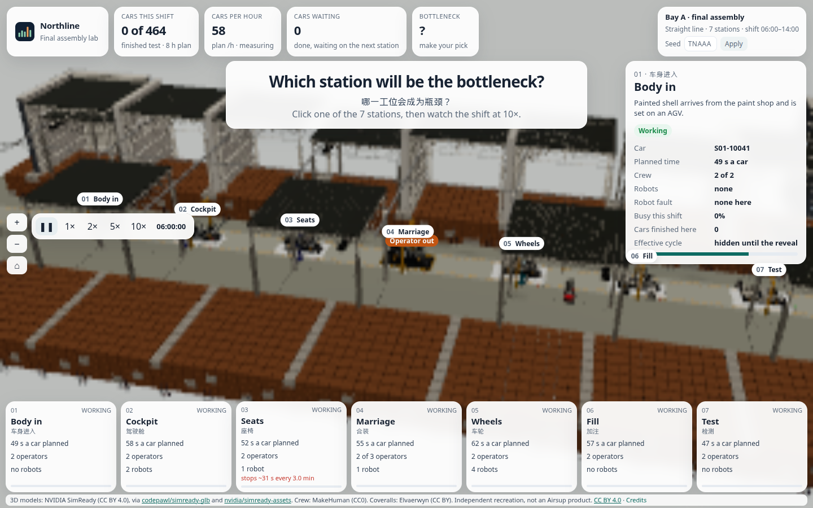
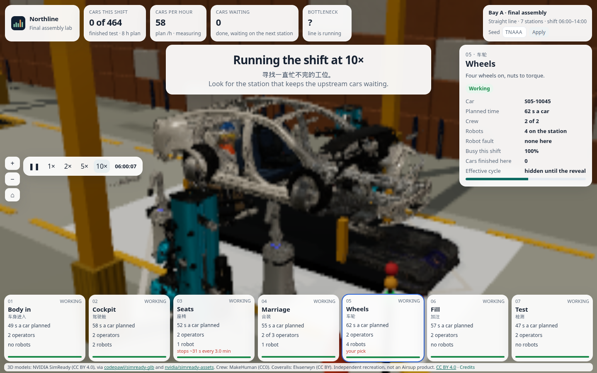

# Northline

A browser simulation of a car final-assembly line: seven stations on one straight east-west aisle, cars moving on AGVs, and a short game about which station is the bottleneck.

This is an independent recreation. It is not an Airsup product, and it does not use their name, logo, or interface code.

## Run

```bash
npm install
npm run dev
```

Open [http://127.0.0.1:4317](http://127.0.0.1:4317). `npm install` only downloads models that are not already in `public/models/`.

```bash
npm test          # seeded generator checks
npm run build     # typecheck and production bundle at site root /
npm run build:pages  # same app at /northline-car-line/ for GitHub Pages
npm run assets    # re-download and simplify SimReady GLBs (FORCE_LOD=1 to rebuild LODs)
```

`npm run dev` and `npm run build` keep asset URLs at the site root (`/models/plant/...`). `npm run build:pages` sets the Vite base to `/northline-car-line/`, which is the project-site path for a repository named `northline-car-line`. Camera, stations, seed `TNAAA`, rack density, and lighting are the same in both builds.

GitHub Pages is configured in `.github/workflows/pages.yml`. It installs without re-downloading models (they are already in `public/`) and publishes the Pages build. In the repository settings, Pages must use GitHub Actions as the source. The site is then `https://<user>.github.io/northline-car-line/?seed=TNAAA`. This checkout is not that deployment until the repository exists and the workflow has run.

The dev server prefers WebGPU and falls back to WebGL 2 when no adapter is available. Orbit with the left mouse button, pan with the right button, zoom with the wheel. The left-side buttons are zoom in, zoom out, and home. Speeds are pause (0), 1×, 2×, 5×, and 10×. Space pauses. `1` `2` `5` `0` set 1×, 2×, 5×, and 10×. `H` returns home.

## The shift

The clock starts at 06:00:00. Click a station to guess the bottleneck. The camera eases in and the shift runs at 10×. When the measured leader matches the steady-state constraint, the camera eases to that station and a verdict opens. The line keeps moving under the card.

Same seed, same line. The URL accepts `?seed=` and `?pick=` (`body`, `cockpit`, `seats`, `marriage`, `wheels`, `fill`, `test`).

[`?seed=TNAAA&pick=wheels`](http://127.0.0.1:4317/?seed=TNAAA&pick=wheels) is one seed the generator actually produces, not a hardcoded story: Marriage is short one of three operators (about 71 s/car), and Seats has a cyclic robot stop (about 31 s every 3.0 min). Another seed will pick different stations and different fault timing.

Rates, cars in an 8-hour shift, and the demo score are simulated values for that seed. There is no player leaderboard. The demo score is `round(100 × your station's effective seconds / the constraint's seconds)`, so the constraint itself scores 100.

## How the line is generated

Standard work is fixed. The seed does two things: it removes one operator from one station (`op`), and it gives one station that already has robots a cyclic stop (`fault`). Every other station is `plain`. A fault is never stacked on the short-staffed station.

Operator work is a fraction of the planned cycle and stretches by `nominal / present`. A robot fault divides that process time by availability (`1 − stop / period`).

The published window is 7,200 s. Seconds per car is the mean interval between cars leaving Test during the last 600 s. Cars in an 8-hour shift are `floor(8 × 3600 / spc)`. The plan rate uses the slowest planned station, before disruptions.

The visual line is the same process model, started with work already in the stations. Buffers hold two cars. Travel between stations is 6.5 s.

## Layout

Stations sit on y = 0, spaced 14.8 m, Body in at x = −58, then Cockpit, Seats, Marriage, Wheels, Fill, Test. Cars only move toward +X. The home camera is target `(−12, 0, −1)`, distance 100, azimuth 0.25 rad, elevation 0.58 rad, fov 32.

The floor is marked FROM PAINT (west), TO TRANSPORTERS (east), and BUFFER between stations. Marriage has a dark pit with a yellow/black hazard border. Test is an open arch, not a light tunnel.

## Models and license

3D models are NVIDIA SimReady, CC BY 4.0. Credit on screen links [codepawl/simready-glb](https://huggingface.co/datasets/codepawl/simready-glb), [nvidia/simready-assets](https://huggingface.co/datasets/nvidia/simready-assets), and the [CC BY 4.0 license](https://creativecommons.org/licenses/by/4.0/).

The packaged filenames the line needs (`body.glb`, `amr.glb`, `cobot.glb`, `crane.glb`, `hall_corner.glb`, `hall_straight.glb`, `hall_center.glb`, `changer.glb`, the tire and rim, and the crew files) are **not** in the Hugging Face GLB dataset. These URLs 404:

- `https://huggingface.co/datasets/codepawl/simready-glb/resolve/main/glb/body.glb`
- `https://huggingface.co/datasets/codepawl/simready-glb/resolve/main/glb/amr.glb`
- `https://huggingface.co/datasets/codepawl/simready-glb/resolve/main/glb/cobot.glb`
- `https://huggingface.co/datasets/codepawl/simready-glb/resolve/main/glb/hall_corner.glb`
- `https://huggingface.co/datasets/codepawl/simready-glb/resolve/main/glb/crane.glb`

They are vendored from the public static mirror listed in the resource inventory (`https://www.airsup.ai/plm/rocket-engine/…`) by `scripts/fetch-plant.mjs`, which `npm install` runs. The app does not fetch them at runtime. `carplant/m/tank.glb` and `carplant/m/wheels.glb` are 404 on that mirror; wheels are the tire mesh plus the rim mesh.

Crew files are MakeHuman bodies (CC0) in Elvaerwyn coveralls (CC BY). GLBs are meshopt-compressed and load with `MeshoptDecoder`. The warehouse HDR is `empty_warehouse_01_1k.hdr`.

## What matches, and what is approximate

Matched:

- One straight line, not a U. Pitch, origin, travel direction, and the home camera above.
- Seven stations, AGVs that stop and move, a crew-short station, a robot that stops and clears, queues upstream of the slow station.
- Pick, run at 10×, reveal. Same seed, same line. `?seed=` and `?pick=`.
- Station cards and an inspect panel: name, status, car, crew, robots, busy, events.
- Simulated rates labeled as such. No “other players” count.

Approximated, honestly:

- Listed station times stay on the fixed balance that makes seed `TNAAA` the Marriage short-crew story. The inventory generator also reshuffles listed times per seed; this build does not, so other seeds will not match that lab number for number.
- Dash, seats, powertrain, and tire+rim are the real meshes, placed in the body from its bounding box. They are not a CAD-accurate mate, so a close car can show parts sitting a little proud of the shell.
- The home camera stays a high three-quarter: distance 108, elevation 0.52, fov 35, target (−14, 0.4, −1). Hall bays keep their native height. The far wall is a continuous run of hall modules; the near side is every other center bay, set back, with the carton rows in front of those columns and still under the sightline.
- The reference recording’s “44” score and “407 other players” are not reproduced. For TNAAA the steady-state line is about 50.7 cars/hour and 405 cars in eight hours, against a plan of 58/h and 464. The demo score for picking Wheels is 87.

### Wide view



Stations 1 through 7 sit on one east-west aisle, Body in on the left and Test on the right. The home camera is unchanged from the readable overview: near columns stay behind the carton rows and do not cover the cars or the station signs.

Against kf_0 the aisle is now flanked by a continuous brown carton wall on both sides, nine rows on the camera side and seven on the far side, four layers high. Exposure is 0.64 with a darker concrete floor and a dimmer hemisphere fill, so the hall is less blown out than the previous wide shot. Two gaps remain. The carton faces are box volumes shaded with the SimReady cardboard and paper colors (and the pallet base-color map when it binds). The pallet mesh itself is quantized, and instancing that geometry did not draw, so the loads do not have the photographed flaps and mixed SKUs of kf_0. Contact shadows are real directional shadows, not a screen-space AO pass, so the floor under the line is darker than before but still flatter than the reference.

### Wheels close-up



The ease-in is unchanged: a darker three-quarter of the SimReady shell on a black deck with yellow posts, a yellow gantry, a teal changer, and cobots beside the body. The new carton rows sit behind that camera, so they read as a brown backdrop instead of blocking the car. Earlier stations use a dark clearcoat; from Wheels onward the shell is a light body-in-white. Against kf_215 the four arms do not all reach the hubs. The cobot joints are posed with a shoulder bend, not an inverse-kinematics solve onto the nuts. A crew member stands on the camera side of the station and is often partly behind the gantry. The reference car is a more complete, darker painted shell with glass.
